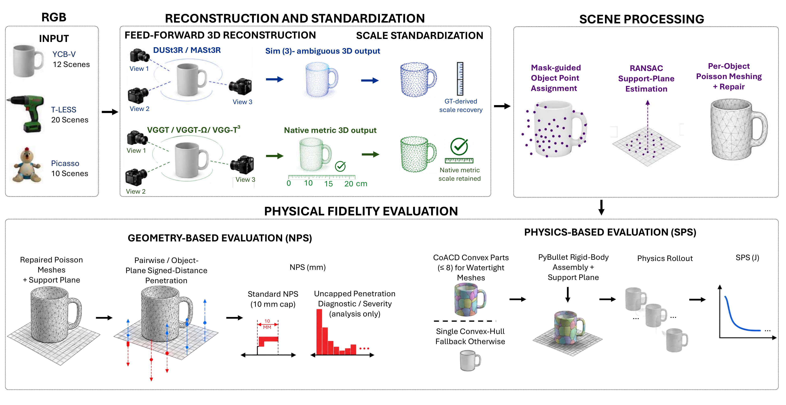

# Benchmarking the Physical Fidelity of Feed-Forward 3D Reconstruction for Physical AI

**Kamran Gholizadeh HamlAbadi**<sup>1</sup>, **Monica Vahdati**<sup>1</sup>, **Ali Etemad**<sup>2</sup>, **Abdulmotaleb El Saddik**<sup>1</sup>

<sup>1</sup>MCRLab, University of Ottawa &nbsp;&nbsp; <sup>2</sup>Queen's University

The International Workshop on Industrial Physical AI (WIPAI '26), ACM Multimedia 2026, Rio de Janeiro

[](https://dl.acm.org/doi/abs/10.1145/3841560.3841563)
[](https://www.researchgate.net/publication/417640419_Benchmarking_the_Physical_Fidelity_of_Feed_Forward_3D_Reconstruction_for_Physical_AI)
[](https://physfidelity3d.github.io/)
[](https://github.com/kamranghz/PhysFidelity3D/actions/workflows/ci.yml)



We compare five feed-forward reconstruction models (DUSt3R, MASt3R, VGGT, VGGT-Ω, VGG-T³) on 42 scenes
from YCB-V, T-LESS and Picasso, giving 210 evaluations through one shared pipeline. Physical fidelity is
measured with the Non-Penetration Score (NPS, penetration before simulation) and the Scene Plausibility
Score (SPS, kinetic energy after a short PyBullet rollout), as defined in Picasso. Lower is better for both.

| Method | NPS [mm] | SPS [J] | Cap-hit [%] |
|:--|--:|--:|--:|
| DUSt3R | **2.351** | 3.430 | **7.9** |
| MASt3R | 2.785 | 2.628 | 12.3 |
| VGGT | 3.165 | 2.727 | 17.1 |
| VGGT-Ω | 2.779 | **1.467** | 12.5 |
| VGG-T³ | 3.321 | 2.550 | 16.4 |

Pooled means over 42 scenes (Table 2 of the paper). The scene-bootstrap 95% confidence intervals reported
in the paper overlap substantially, especially for SPS.

## What this repository contains

- `data/records/`: the 210 evaluation records (NPS, SPS and mesh statistics per method and scene).
- `physfidelity3d/`: the analysis code that recomputes every table, figure and in-text statistic of the
  paper from these records.
- `data/recorded/`: results of Tables 3–5 and Figs. 7–9. These need the reconstructions and ground truth,
  which are not redistributed, so they are provided as recorded values and printed by the same code.

The reconstruction and simulation pipeline, and the point clouds of Fig. 10, are not part of this release.

## Reproduce the paper

```bash
git clone https://github.com/kamranghz/PhysFidelity3D.git
cd PhysFidelity3D
pip install -e ".[dev]"

python -m physfidelity3d validate      # checksums and record counts
python -m physfidelity3d reproduce     # all tables and figures in outputs/ (about 30 s, CPU only)
pytest                                 # checks every number printed in the paper
```

Python 3.10 or newer. `make validate`, `make reproduce` and `make test` run the same commands.

| Paper | Output |
|:--|:--|
| Table 2 | `outputs/tables/table2_pooled.csv` |
| Table 3, Section 4.2 | `table3_geometry.csv`, `geometry_correlations.csv` |
| Table 4, Fig. 7 | `table4_gt_aligned.csv`, `figures/fig7_gt_aligned.pdf` |
| Table 5, Fig. 8 | `table5_vggt_family.csv`, `figures/fig8_vggt_family.pdf` |
| Table 6 | `table6_coverage.csv` |
| Table 7 | `table7_collision_geometry.csv` |
| Table 8 | `table8_failure_cases.csv` |
| Fig. 2 | `figures/fig2_pooled.pdf` |
| Fig. 3, Section 4.1 | `rank_probabilities.csv`, `paired_vs_dust3r.csv`, `figures/fig3_ranking_uncertainty.pdf` |
| Fig. 4, Section 4.3 | `dataset_means.csv`, `figures/fig4_dataset_specific.pdf` |
| Fig. 5, Section 4.4 | `nps_sps_correlation.csv`, `figures/fig5_nps_sps.pdf` |
| Fig. 6, Section 4.5 | `nps_saturation.csv`, `cap_hit_by_dataset_method.csv`, `figures/fig6_saturation.pdf` |
| Fig. 9 | `scale_perturbation.csv`, `figures/fig9_scale_perturbation.pdf` |

## Repository layout

```
physfidelity3d/
  config.py      methods, datasets, bootstrap settings
  records.py     loads the 210 records, verifies checksums
  bootstrap.py   scene-cluster bootstrap estimators
  tables.py      one function per table or statistic of the paper
  figures.py     Figs. 2-9
  __main__.py    command line: validate, reproduce
tests/           record integrity and every printed paper value
data/            records, recorded results, checksums, JSON schemas
```

The record format is described in [docs/data_format.md](docs/data_format.md).

## License

Code: [MIT](LICENSE). Records and recorded results in `data/`: [CC BY 4.0](LICENSE-DATA).

## Citation

```bibtex
@inproceedings{10.1145/3841560.3841563,
  author    = {Gholizadeh HamlAbadi, Kamran and Vahdati, Monica and Etemad, Ali and El Saddik, Abdulmotaleb},
  title     = {Benchmarking the Physical Fidelity of Feed-Forward 3D Reconstruction for Physical AI},
  booktitle = {Proceedings of the 1st International Workshop on Industrial Physical AI},
  series    = {WIPAI '26},
  pages     = {31--41},
  year      = {2026},
  publisher = {Association for Computing Machinery},
  address   = {New York, NY, USA},
  location  = {Rio de Janeiro, Brazil},
  doi       = {10.1145/3841560.3841563}
}
```

Contact: Kamran Gholizadeh HamlAbadi, kghol072@uottawa.ca
